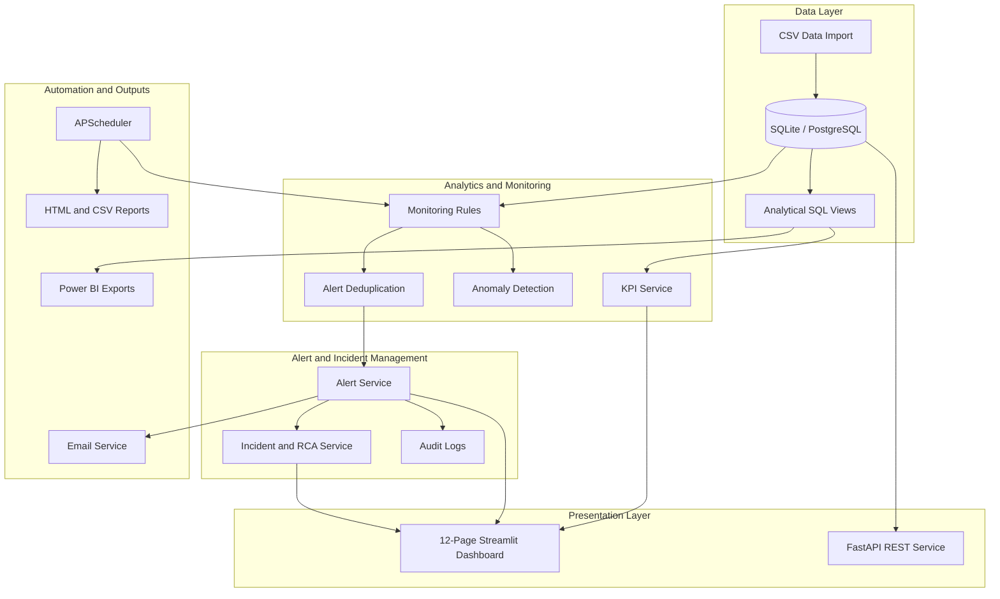

# Intelligent Business Process Monitoring & Auto-Alert System

An automated business operations monitoring platform built with **Python, Streamlit, FastAPI, SQLAlchemy, SQLite, and Plotly**. It helps teams identify operational delays, transaction failures, budget overruns, and other business risks through SQL-driven KPIs, configurable monitoring rules, anomaly detection, incident tracking, and automated notifications.

The platform brings operational data into one place, turns it into actionable insights, and helps teams respond before small issues become larger problems.

---

## Table of Contents

- [Overview](#overview)
- [The Problem](#the-problem)
- [What the System Does](#what-the-system-does)
- [Architecture](#architecture)
- [Key Features](#key-features)
- [Technology Stack](#technology-stack)
- [Project Structure](#project-structure)
- [Getting Started](#getting-started)
- [Running the FastAPI Service](#running-the-fastapi-service)
- [Production Configuration](#production-configuration)
- [Environment Variables](#environment-variables)
- [Automated Tests](#automated-tests)
- [Power BI Integration](#power-bi-integration)
- [Email Notification Modes](#email-notification-modes)
- [Security Notes](#security-notes)
- [Known Limitations and Future Improvements](#known-limitations-and-future-improvements)

---

## Overview

The **Intelligent Business Process Monitoring & Auto-Alert System** is designed to monitor important business workflows across multiple operational areas:

- Task and SLA performance
- Customer order fulfillment
- Payment transaction reliability
- Department expenses and budget variance
- Alerts, incidents, and resolution performance

It combines a Streamlit operational dashboard with a separate FastAPI service. Monitoring rules evaluate operational data, anomaly detection identifies unusual patterns, and the alert and incident services support investigation and resolution.

The application supports local development with SQLite and is designed to be configurable for PostgreSQL deployments.

## The Problem

Business teams often depend on spreadsheets, manual status checks, and disconnected reports to understand whether operations are running smoothly. This can make it difficult to identify:

- Tasks that have passed their deadlines.
- Orders that are likely to be delivered late.
- Sudden increases in payment failures.
- Expenses that exceed expected budgets.
- Repeated operational issues that need investigation.

This project addresses these challenges through centralized monitoring, configurable rules, automated alerts, and performance reporting.

## What the System Does

```text
Operational Data
      |
      v
Data Import and Database
      |
      v
SQL Views and KPI Calculations
      |
      v
Monitoring Rules and Anomaly Detection
      |
      v
Alert Creation and Deduplication
      |
      v
Incident Tracking and Audit Logs
      |
      +-------------------+
      |                   |
      v                   v
Streamlit Dashboard   Email Notifications
      |
      v
Reports and Power BI Exports
```

## Architecture

The system is organized into five logical layers:

1. **Data layer** – imports operational CSV data and stores records in the database.
2. **Analytics and monitoring layer** – calculates KPIs, evaluates monitoring rules, and detects anomalies.
3. **Alert and incident layer** – manages alert lifecycles, incident grouping, resolution tracking, and audit logs.
4. **Automation layer** – schedules monitoring jobs, generates reports, and dispatches email notifications.
5. **Presentation layer** – provides the Streamlit dashboard and supports Power BI data exports.

### Architecture Diagram



---

## Key Features

### 1. Multi-Domain Operational Monitoring

| Area | Monitoring capabilities |
|---|---|
| **Tasks** | Detects incomplete tasks past their deadlines, calculates overdue duration, and tracks team SLA completion rates. |
| **Orders** | Tracks order fulfillment, delivery delays, and high-value customer order risks. |
| **Transactions** | Monitors payment failure rates, possible gateway outage spikes, and error categories such as timeout, insufficient funds, and fraud. |
| **Expenses** | Identifies budget overruns and statistical outliers using Z-scores and Tukey IQR fences. |
| **Departments** | Compares department performance, SLA compliance, and expenditure. |

### 2. Configurable Monitoring Rules

The monitoring service evaluates **seven core business rules** to identify operational issues. Rule thresholds can be configured through application settings.

### 3. Statistical Anomaly Detection

The anomaly service uses:

- **Z-score analysis** to identify values that are unusually far from the mean.
- **Tukey IQR fences** to identify statistical outliers.
- **Budget variance checks** to detect spending beyond configured limits.

These methods provide measurable indicators that help users understand why a record was flagged.

### 4. Alert Deduplication

The system uses an alert fingerprint based on:

`rule_code:entity_type:entity_id`

This prevents repeated monitoring runs from creating duplicate unresolved alerts for the same issue.

### 5. Alert Lifecycle and Audit Trail

Alerts move through a defined lifecycle:

`New → Acknowledged → In Progress → Resolved / Dismissed`

The system supports owner assignment, resolution notes, timestamps, and audit logging.

### 6. Incident Management and Root-Cause Analysis

- Groups related alerts into parent incidents.
- Tracks Mean Time to Acknowledge (**MTTA**).
- Tracks Mean Time to Resolve (**MTTR**).
- Examines statistical correlations across vendors, payment methods, and teams.
- Distinguishes observed correlation from proven causation.

### 7. Automated Scheduling

- Uses APScheduler for recurring monitoring and daily report generation.
- Includes a thread-safe singleton scheduler design to reduce duplicate scheduler creation during Streamlit hot reloads.
- Supports manual monitoring runs and execution history.

### 8. Automated Email Notifications

- Supports SMTP email dispatch with TLS authentication and retry handling.
- Includes a simulated demo mode that works without SMTP credentials.
- Logs simulated notifications locally and clearly indicates that they were not delivered.

### 9. Executive Reports

Generates responsive HTML reports and structured CSV summaries with operational metrics and data-driven recommendations.

### 10. Power BI Integration

Provides analytical SQL views and downloadable CSV datasets for use in Power BI Desktop or Service.

---

## Technology Stack

| Category | Technologies |
|---|---|
| Programming language | Python 3.11+ |
| Dashboard | Streamlit |
| REST API | FastAPI |
| Database | SQLite, PostgreSQL-compatible configuration |
| ORM | SQLAlchemy 2.0 |
| Data processing | Pandas, NumPy |
| Data visualization | Plotly Express, Plotly Graph Objects |
| Anomaly detection | Scikit-learn, SciPy, Z-score, Tukey IQR |
| Background scheduling | APScheduler |
| Email notifications | Python `smtplib`, `email.mime` |
| Testing | Pytest |
| BI integration | Microsoft Power BI |

---

## Project Structure

```text
business-process-monitor/
│
├── .env.example
├── .gitignore
├── README.md
├── requirements.txt
├── app.py
├── ui_common.py
│
├── config/
│   ├── __init__.py
│   └── settings.py
│
├── database/
│   ├── __init__.py
│   ├── connection.py
│   ├── schema.py
│   ├── seed_data.py
│   └── views.py
│
├── services/
│   ├── __init__.py
│   ├── data_import_service.py
│   ├── kpi_service.py
│   ├── monitoring_service.py
│   ├── anomaly_service.py
│   ├── alert_service.py
│   ├── incident_service.py
│   ├── email_service.py
│   └── report_service.py
│
├── jobs/
│   ├── __init__.py
│   ├── scheduler.py
│   └── monitoring_job.py
│
├── pages/
│   ├── 1_📊_Executive_Dashboard.py
│   ├── 2_📋_Tasks_Monitor.py
│   ├── 3_📦_Orders_Monitor.py
│   ├── 4_💳_Transactions_Monitor.py
│   ├── 5_💰_Expenses_&_Anomalies.py
│   ├── 6_🚨_Alert_Center.py
│   ├── 7_🔍_Incident_Management.py
│   ├── 8_📑_Reports_&_Exports.py
│   ├── 9_📥_Data_Import.py
│   ├── 10_⚙️_Monitoring_Rules.py
│   ├── 11_⏱️_Automation_&_Settings.py
│   └── 12_👤_User_Management.py
│
├── sample_data/
│   ├── tasks_sample.csv
│   ├── orders_sample.csv
│   ├── transactions_sample.csv
│   └── expenses_sample.csv
│
├── tests/
│   ├── conftest.py
│   ├── test_monitoring.py
│   ├── test_alerts.py
│   ├── test_kpis.py
│   ├── test_data_import.py
│   ├── test_anomaly.py
│   ├── test_reports.py
│   └── test_email.py
│
├── logs/
└── reports/
```

> **Note:** The setup instructions also reference the `api` package and `database.bootstrap_admin` module. Make sure those paths are present in the repository and add them to this tree if they are part of your current implementation.

---

## Getting Started

### Prerequisites

Install the following before running the project:

- Python 3.11 or later
- pip
- Git (optional, for cloning the repository)

### 1. Clone the Repository

```bash
git clone <YOUR_GITHUB_REPOSITORY_URL>
cd business-process-monitor
```

If you already have the project locally, open a terminal in the project directory instead.

### 2. Create a Virtual Environment

**Windows PowerShell:**

```powershell
python -m venv .venv
.\.venv\Scripts\Activate.ps1
```

**macOS / Linux:**

```bash
python3 -m venv .venv
source .venv/bin/activate
```

### 3. Install Dependencies

```bash
python -m pip install --upgrade pip
pip install -r requirements.txt
```

### 4. Configure Environment Variables

Create a local `.env` file from the example:

**Windows PowerShell:**

```powershell
Copy-Item .env.example .env
```

**macOS / Linux:**

```bash
cp .env.example .env
```

Review the configuration values before starting the application. Keep `.env` out of version control.

### 5. Initialize and Run the Dashboard

The application creates the database tables and analytical views on first dashboard launch. In development, `SEED_DEMO_DATA=True` loads synthetic sample records and demo accounts.

Run:

```bash
streamlit run app.py
```

Open the dashboard at:

**http://localhost:8501**

### Development Demo Accounts

When demo data is enabled, the seeded accounts are:

| Role / Account | Username | Password |
|---|---|---|
| Admin | `admin` | `Admin@123` |
| Manager | `manager` | `Manager@123` |
| Analyst | `analyst` | `Analyst@123` |

These are development-only credentials. Do not use them in a production deployment.

---

## Running the FastAPI Service

The REST API runs separately from the Streamlit dashboard. The documented data routes require a bearer token.

Start the API from the project root:

```bash
python -m uvicorn api.main:app --host 127.0.0.1 --port 8000
```

Open the interactive API documentation:

**http://127.0.0.1:8000/docs**

### Authentication

1. Send a login request to `POST /api/auth/login`.
2. Obtain the access token returned by the API.
3. Include the token in requests to protected data routes:

```http
Authorization: Bearer <your-access-token>
```

---

## Production Configuration

Before deploying the application:

1. Set `APP_ENV=production`.
2. Set `DEBUG=False`.
3. Set `SEED_DEMO_DATA=False`.
4. Generate a unique API signing secret.
5. Configure allowed CORS origins.
6. Configure production database and SMTP settings as required.
7. Create the first administrator account.
8. Keep credentials and secrets out of source control.

Generate a signing secret using Python:

```powershell
python -c "import secrets; print(secrets.token_urlsafe(48))"
```

Set the generated value as `API_TOKEN_SECRET` in `.env`.

Configure `API_CORS_ORIGINS` with only the browser origins that should be permitted to call the API.

Create the first administrator using the documented bootstrap command:

```powershell
python -m database.bootstrap_admin
```

The application documentation states that existing legacy password hashes are upgraded to PBKDF2 automatically after a successful login.

---

## Environment Variables

Copy `.env.example` to `.env` and configure the values for your environment.

| Variable | Default | Description |
|---|---|---|
| `DATABASE_URL` | `sqlite:///business_monitor.db` | SQLAlchemy database connection string. |
| `SEED_DEMO_DATA` | `True` in development | Loads synthetic sample records and demo users when enabled. |
| `API_TOKEN_SECRET` | Random per process in development | Signing secret; configure a persistent secret outside development. |
| `API_TOKEN_TTL_MINUTES` | `480` | Bearer token lifetime in minutes. |
| `API_CORS_ORIGINS` | Local Streamlit origins | Comma-separated list of permitted browser origins. |
| `DEFAULT_MONITORING_INTERVAL_MINUTES` | `60` | Interval between background monitoring cycles. |
| `TRANSACTION_FAILURE_THRESHOLD_PCT` | `5.0` | Maximum acceptable transaction failure percentage. |
| `COST_ANOMALY_ZSCORE_THRESHOLD` | `2.5` | Z-score threshold for cost outliers. |
| `COST_BUDGET_OVERRUN_THRESHOLD_PCT` | `20.0` | Budget overrun threshold percentage. |
| `DEPARTMENT_SLA_MIN_COMPLETION_RATE` | `80.0` | Minimum department task completion SLA percentage. |
| `INCIDENT_RESOLUTION_SLA_HOURS` | `48` | Target incident resolution time in hours. |
| `SMTP_HOST` | `smtp.gmail.com` | SMTP server hostname. |
| `SMTP_PORT` | `587` | SMTP port; 587 is commonly used with TLS. |
| `SMTP_USERNAME` | Empty | SMTP login account. |
| `SMTP_PASSWORD` | Empty | SMTP app password. |
| `SMTP_FROM_EMAIL` | `alerts@businessmonitor.local` | Sender email address. |
| `ALERT_RECIPIENT_EMAIL` | `ops-manager@businessmonitor.local` | Default alert recipient. |
| `ENABLE_EMAIL_ALERTS` | `False` | Set to `True` to enable real email dispatch. |

---

## Email Notification Modes

The application supports two email modes.

### Simulated Demo Mode

Demo mode is active when `ENABLE_EMAIL_ALERTS=False` or SMTP credentials are not configured.

- No external email is sent.
- Notification content is written to `logs/app.log`.
- The application indicates that the notification was simulated and not delivered.
- The dashboard includes a **Send Test Email** diagnostic action.

### Live SMTP Mode

To enable real email delivery:

1. Configure the SMTP host and port.
2. Set the SMTP username and app password.
3. Set the sender and recipient email addresses.
4. Set `ENABLE_EMAIL_ALERTS=True`.
5. Test delivery using the dashboard's email diagnostic action.

Use an app password where required by your email provider. Never commit SMTP credentials to GitHub.

---

## Automated Tests

Run the test suite from the project root:

```bash
python -m pytest tests/ -v
```

The documented test modules cover:

- Monitoring rules
- Alert lifecycle
- KPI calculations
- Data import
- Anomaly detection
- Report generation
- Email functionality

---

## Power BI Integration

The application provides analytical SQL views and CSV exports for business intelligence reporting.

### Option 1: Connect Through SQLite ODBC

1. Install a compatible SQLite ODBC driver.
2. Open Power BI Desktop.
3. Select **Get Data → ODBC**.
4. Select your SQLite DSN or configure a connection using your local database file.
5. Load the available analytical views.

The documented views include:

- `v_department_performance`
- `v_overdue_tasks`
- `v_delayed_orders`
- `v_transaction_rates`
- `v_expense_variances`
- `v_open_alerts`

### Option 2: Import CSV Exports

1. Start the Streamlit application.
2. Open **Reports & Exports**.
3. Select the required dataset.
4. Download the corresponding CSV file.
5. Import the CSV into Power BI Desktop.

The CSV approach is useful when you want to build reports without configuring a direct database connection.

---

## Security Notes

- Do not commit `.env` files, API secrets, SMTP credentials, or production database files.
- Disable demo data and demo accounts in production.
- Replace development credentials before deployment.
- Use a persistent, securely generated `API_TOKEN_SECRET` outside development.
- Restrict CORS origins to trusted front-end domains.
- Use HTTPS and secure infrastructure when exposing the API beyond localhost.
- Use synthetic data for demonstrations unless production data access has been explicitly authorized.

---

## Known Limitations and Future Improvements

| Area | Current position / possible improvement |
|---|---|
| Database concurrency | SQLite uses WAL mode for local read/write concurrency. PostgreSQL is the recommended direction for higher multi-user write throughput. |
| Notifications | Webhook, Slack, and Microsoft Teams integrations could extend the SMTP notification service. |
| Predictive analytics | ARIMA or Prophet-based forecasting could be added to estimate future delivery delays and operational trends. |

---

## Project Goal

The goal of this project is to demonstrate how operational data, SQL analytics, Python automation, anomaly detection, and business intelligence can work together in one monitoring platform.

**Monitor operations. Detect risks early. Turn business data into action.**
